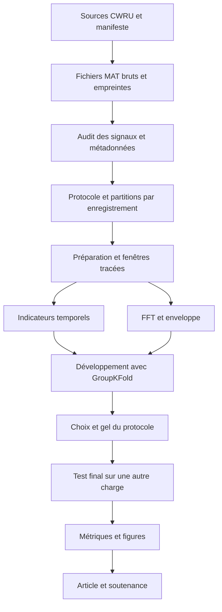

# Mouhamedou Yahya Cheikh Med Vall
# 25239
# Maryeim Mohamed T'Feil
# 22087

# Architecture technique du mini-projet AML313 du groupe 7

Dernière mise à jour : **21 novembre 2026**. Statut : **pipeline scientifique exécuté, test final consulté et reproduction vérifiée**.

## 1. Rôle et principes

Ce fichier est la source de vérité technique. [ROADMAP.md](ROADMAP.md) porte les objectifs et l'avancement. L'[énoncé](Mini-projet-AML313.pdf), page 10, impose la baseline, les tâches physiques et le découpage par enregistrement. Les instructions explicites de l'utilisateur priment ; toute adaptation est documentée.

Le projet utilise un pipeline Python local, exécuté en lot sur CPU. Le même code produit les caractéristiques, les expériences, les figures et les tables de l'article. Les notebooks peuvent expliquer ou explorer le développement ; ils ne portent pas une seconde implémentation du pipeline.

## 2. Vue d'ensemble



Les signaux de la charge finale ne servent pas à choisir les paramètres, les caractéristiques ou les exemples du développement. Les contrôles d'intégrité et de métadonnées sont permis sur tous les fichiers ; ils restent distincts de l'inspection des performances.

## 3. Pile et modules implémentés

| Composant | Choix initial | Rôle |
| --- | --- | --- |
| Exécution | Python 3.12.14 en environnement isolé | Versions installées et vérifiées ; requirements.lock.txt fait autorité. |
| Signaux et calcul | NumPy, SciPy | MAT, rééchantillonnage, filtres, FFT et enveloppe. |
| Tables | pandas, CSV et JSON | Manifestes, caractéristiques et résultats. |
| Modèles | scikit-learn | Arbre, forêt, validation groupée et métriques. |
| Figures | Matplotlib | Figures statiques pour le rapport. |
| Configuration | JSON et bibliothèque standard | Paramètres et empreinte du protocole. |
| Vérification | pytest | Tests ciblés sur calculs physiques et frontières de validation. |

Aucun serveur, GPU, service cloud ou base de données n'est nécessaire dans le périmètre initial. Les versions exactes sont figées dans `requirements.lock.txt` ; deux environnements isolés et un clone distinct ont reproduit les résultats.

Organisation du pipeline, avec dossiers générés créés à la demande :

```text
mini-project/
  README.md, ROADMAP.md, ARCHITECTURE.md, tasks.md, AGENTS.md
  Mini-projet-AML313.pdf
  pyproject.toml                  # paquet et dépendances déclarées
  requirements.lock.txt           # environnement exact vérifié
  Makefile                       # point d'entrée de reproduction
  configs/experiment.json        # paramètres scientifiques
  data/
    manifest.csv                 # provenance et métadonnées
    raw/                         # fichiers originaux, jamais modifiés
    processed/                   # signaux dérivés et caractéristiques
    splits/                      # groupes et plis figés
  src/bearing_diagnosis/
    cli.py                       # orchestration
    data.py                      # téléchargement, MAT, manifeste et audit
    splits.py                    # réservation de charge et GroupKFold
    signals.py                   # préparation, fenêtres, FFT et enveloppe
    features.py                  # indicateurs
    models.py                    # modèles et recherche bornée
    evaluation.py                # métriques et incertitude
    reporting.py                 # figures et tables
  tests/
  notebooks/                     # explications utilisant le paquet
  outputs/<run_id>/              # paramètres, journaux et résultats
  report/                        # article et sources
  presentation/                  # soutenance
```

Le manifeste, les configurations et les partitions sont versionnés. Les données brutes volumineuses et caches ne le sont pas par défaut. Vérifier les conditions d'utilisation avant redistribution ; accessibilité publique ne signifie pas licence de redistribution établie.

Le dépôt Git a pour racine `mini-project/`, pour branche principale `main` et pour distant `origin` l'URL `https://github.com/Lavdal-Yahya/IoT-mini-project.git`. Le fichier `.gitignore` exclut les environnements, caches, secrets locaux, `data/raw/`, `data/processed/`, `outputs/` et `tmp/`. Les cours et TPs du dossier parent restent hors du dépôt. Les résultats sélectionnés pour la livraison sont versionnés dans `results/`, avec leurs empreintes et leurs références.

## 4. Données et interfaces

### 4.1 Sous-ensemble retenu après audit

Sous-ensemble vérifié en M1 : roulement côté entraînement, canal `DE`, quatre classes `healthy`, `inner_race`, `outer_race`, `ball`, tailles de défaut 0,007/0,014/0,021 pouce et une position externe cohérente, fixée à 6 h selon la table officielle [S4], avec les enregistrements sains correspondants [S5].

Charges retenues : **0, 1 et 2 HP pour développer ; 3 HP pour le transfert final**. Cette répartition a été contrôlée avant l'entraînement. Un changement se décide sur les métadonnées avant les scores.

Fréquence commune retenue : **12 000 Hz**. Vérifier la fréquence native de chaque canal et fichier ; ne pas la déduire du seul nom du dossier. Appliquer un passe-bas causal harmonisé à tous les fichiers : 41 coefficients à 12 kHz, 161 à 48 kHz, coupure 4,8 kHz. Décimer seulement les fichiers à 48 kHz après ce filtre. Une fréquence non vérifiable met le fichier en attente.

### 4.2 Contrats de données

Une ligne de `manifest.csv` décrit un canal d'un enregistrement source. Champs requis : `recording_id`, `group_id`, `source_url`, `local_path`, `file_sha256`, `signal_sha256`, `mat_key`, `sensor_location`, `bearing_location`, `class_label`, `fault_diameter_in`, `outer_race_position`, `load_hp`, `rpm`, `fs_native_hz`, `n_samples`, `duration_s`, `units`, `metadata_source`, `inclusion_status`, `exclusion_reason`.

Une information inconnue est explicitement manquante et justifiée. Les attributs de défaut sont non applicables aux signaux sains. Classe, taille, charge et identifiants servent à organiser et évaluer les données ; ils n'entrent pas dans la matrice de caractéristiques `X`.

`recording_id` désigne l'essai d'origine ; `group_id` réunit tous ses canaux, copies et dérivés. Les doublons de fichier ou de signal ne deviennent jamais de nouveaux exemples indépendants. Signaler aussi les extraits communs et les relations physiques entre essais lorsqu'elles sont documentées : deux empreintes différentes ne prouvent pas une indépendance physique.

Une fenêtre conserve `window_id`, `recording_id`, `group_id`, `start_sample`, `stop_sample` exclu, `fs_analysis_hz`, `available_at_s`, `class_label` et `split_role`. `window_id` est la clé unique des tables de caractéristiques ; la provenance reste séparée de `X`.

### 4.3 Audit et préparation

Vérifier clés MAT, dimensions, nombres finis, durées, amplitudes, saturation, séquences constantes, doublons et métadonnées. Sans horodatage réel, la grille est relative : `t = sample_index / fs`. Elle ne donne ni dates d'essai, ni ordre chronologique entre fichiers, ni preuve de pertes réseau.

Une valeur répétée peut être légitime : ne pas supprimer les échantillons égaux comme des doublons de lignes. Ne pas imputer automatiquement les lacunes vibratoires ni enlever les pics susceptibles de porter le défaut. Toute exclusion est justifiée. Le journal indique source, méthode, paramètres, tailles avant/après et points retirés.

## 5. Signal et caractéristiques

### 5.1 Fenêtres et causalité

Choix retenu : fenêtres complètes de **1 s sans recouvrement**, soit 12 000 points à 12 kHz et `Δf = 1 Hz`. Aucune alternative de durée n’a été comparée dans cette expérience. Durée et pas sont ensuite figés ; compter les fragments terminaux exclus.

La prédiction d'une fenêtre est disponible à sa fin, lorsque tous ses échantillons sont connus. FFT et enveloppe analytique calculées sur cette fenêtre fermée ne permettent pas de dater une décision avant sa fin. Ne pas appliquer un filtre bidirectionnel sur tout l'enregistrement en le présentant comme causal.

Le passe-bande implémenté est causal, avec état conservé dans un enregistrement et réinitialisé entre essais. Le rééchantillonnage doit documenter son délai, ses bords et sa période transitoire. Mesurer et déclarer la latence totale et les portions exclues ; ne pas supposer un traitement sans délai.

### 5.2 Trois indicateurs de référence

Calculer sur les mêmes fenêtres, avec retrait local de composante continue déclaré :

- `RMS = sqrt(mean(x**2))`.
- Kurtosis de Pearson : moment centré d'ordre 4 divisé par la variance au carré ; convention gaussienne égale à 3. La correction de biais est explicitée et constante entre expériences.
- Facteur de crête : `max(abs(x)) / RMS`.

Signaler les fenêtres d'énergie ou variance nulle ; aucune division par zéro ou correction silencieuse. Le retrait de moyenne ne signifie pas une normalisation de chaque fenêtre à variance unité, qui supprimerait l'information d'amplitude de la baseline.

### 5.3 FFT et enveloppe

Retirer la moyenne locale puis appliquer Hann pour le spectre. Préciser normalisation, unités et résolution `fs / N`. Distinguer l'espacement des raies de la séparation permise par le fenêtrage ; le zero-padding n'améliore pas la résolution physique.

Calculer les fréquences de défaut à partir de la vitesse de chaque essai, avec `f_rotation = rpm / 60` :

```text
BPFO = (n / 2) × f_rotation × (1 − (d / D) × cos(theta))
BPFI = (n / 2) × f_rotation × (1 + (d / D) × cos(theta))
```

`n` : nombre d'éléments roulants ; `d` : diamètre d'une bille ; `D` : diamètre primitif ; `theta` : angle de contact. Ne pas inventer une géométrie manquante. La fiche officielle DE fournit directement `BPFO = 3,5848 × f_rotation` et `BPFI = 5,4152 × f_rotation` ; vérifier la correspondance du roulement retenu [S3].

Chaîne implémentée : passe-bande causal autour d'une résonance justifiée → enveloppe analytique sur fenêtre fermée → retrait de moyenne de l'enveloppe → Hann → spectre. Inspecter les transitoires et effets de bord. La bande 2–5 kHz est fixée et contrôlée sur le développement, sous Nyquist ; elle n’a pas été optimisée par les scores.

Jeu spectral retenu : énergies relatives dans des bandes proches de BPFO/BPFI et de leurs premières harmoniques, avec quelques bandes générales documentées. Calculer les mêmes candidats pour toutes les classes ; aucune fréquence n'est sélectionnée à partir de la vraie étiquette. Tolérances et harmoniques sont figées avant le test.

La vitesse place les bandes physiques mais n'est pas une entrée brute du classifieur initial. Documenter son origine et sa disponibilité, notamment pour une application future sans capteur de vitesse.

## 6. Validation et expériences

### 6.1 Partitions

1. Définir groupes et alias avant de produire les exemples d'apprentissage.
2. Réserver la charge de transfert et ses identifiants ; aucune sélection de bande ou de modèle sur cette charge.
3. Utiliser `GroupKFold` sur les charges de développement, avec **3 plis par charge entière**. Vérifier toutes les classes dans chaque apprentissage et évaluation ; la classe saine peut avoir peu de groupes.
4. Si un pli est invalide, revoir nombre de plis, répartition ou sous-ensemble sur les métadonnées avant les scores. Ne pas mélanger aléatoirement les fenêtres pour contourner ce problème.
5. Ajuster tout prétraitement appris seulement dans l'apprentissage du pli. Les transformations fixes par fenêtre restent déterministes et sans ajustement global.

Le sujet 7 exige une séparation par enregistrement ; les fichiers n'établissent pas forcément une chronologie. Une éventuelle analyse temporelle complémentaire sur des blocs d'un même essai conserve leur ordre et un gap couvrant fenêtres, recouvrement et mémoire du filtre. Elle ne remplace pas l'évaluation sur essais distincts. Ne pas inventer de dates pour simuler une validation chronologique.

### 6.2 Baseline et ablation

| Expérience | Classifieur | Entrées | Rôle |
| --- | --- | --- | --- |
| E1 | Arbre de décision | RMS, kurtosis, facteur de crête | Baseline exigée. |
| E2 | Arbre de décision | Temporelles + spectrales/enveloppe | Effet des caractéristiques à modèle identique. |
| E3 | Forêt aléatoire | Trois indicateurs temporels | Effet du classifieur à entrées identiques. |
| E4 | Forêt aléatoire | Temporelles + spectrales/enveloppe | Candidat enrichi. |

Même découpage, fenêtres et métriques pour E1–E4. Prévoir une petite grille de profondeur et de taille minimale de feuille, avec nombre d'arbres fixe pour la forêt. Grille exacte et graines sont enregistrées avant les essais. Un prédicteur majoritaire peut fournir un repère supplémentaire sans remplacer E1.

Les plis de développement servent à sélectionner les choix ; leur score après sélection n'est pas une nouvelle estimation indépendante. Si une recherche plus large est ajoutée, prévoir des plis groupés internes pour régler et externes pour estimer, sans toucher à la charge finale.

### 6.3 Métriques et incertitude

Rapporter l'exactitude et les matrices de confusion imposées, en nombres et normalisées par vraie classe. Ajouter rappel par classe, exactitude équilibrée et macro-F1. Critère de sélection retenu : exactitude équilibrée donnant le même poids aux enregistrements, puis préférence pour le modèle plus simple à résultats comparables ; règle fixée en M2 et enregistrée dans la configuration.

Conserver les métriques par fenêtre et par enregistrement. Les indicateurs principaux utilisent des poids de fenêtre inverses du nombre de fenêtres de leur enregistrement ; les scores bruts par fenêtre sont complémentaires, car les essais longs peuvent les dominer. Pour un diagnostic agrégé de l'enregistrement, la règle retenue est la moyenne des probabilités de ses fenêtres, annoncée avant l'évaluation.

La dispersion entre plis est descriptive. Un bootstrap rééchantillonne les **enregistrements**, de manière appariée entre modèles et en conservant les classes. Il ne traite pas les fenêtres voisines comme indépendantes. Avec un seul essai de test dans une classe, il ne mesure pas la variabilité entre essais de cette classe : rapporter cette limite et les valeurs individuelles, sans promettre un intervalle représentatif.

Le transfert change la charge et les enregistrements. Une baisse ne doit pas être attribuée exclusivement à la charge. Les scores CWRU ne démontrent pas à eux seuls une généralisation à une autre machine industrielle.

### 6.4 Gel et test final

Avant le test, enregistrer manifeste, partitions, caractéristiques, bandes, modèles, réglages, métriques et empreintes du code/configuration. Réentraîner les expériences annoncées sur tout le développement. Exécuter **une seule campagne finale E1–E4** sur la charge réservée.

Le programme de test exige un fichier de gel et écrit un marqueur de consultation. Une relance identique peut vérifier la reproduction ; toute nouvelle décision scientifique après lecture du test reste exploratoire et demande une évaluation indépendante pour être confirmée. Le programme ne sélectionne ni ne règle automatiquement une méthode à partir du score final.

## 7. Sorties et reproduction

Chaque exécution produit un dossier identifié : configuration résolue, empreintes des données et partitions, versions, graines, journal de préparation, résultats par pli, prédictions avec provenance, métriques et figures. Les tables de l'article sont dérivées de ces sorties ; ne pas saisir à la main des résultats dans le code d'affichage.

Interface implémentée : diagnostic → développement → gel → évaluation finale. La cible `make reproduce` rejoue les calculs gelés et compare les prédictions finales aux références. Les figures et tables sont régénérées par `make report` depuis une exécution complète. URL, empreintes et verrou d’environnement ont permis de reconstruire les entrées et le logiciel depuis un clone propre. Les commandes exactes et le parcours de reproduction sont décrits dans le README.

## 8. Vérifications nécessaires

- Signaux connus : RMS, facteur de crête, convention de kurtosis, pic d'une sinusoïde et résolution FFT.
- Porteuse modulée connue : récupération de la modulation par enveloppe. Cette simulation ne remplace pas les données CWRU.
- Absence de signal partagé, alias, groupe ou fenêtre entre partitions ; couverture des classes.
- Prétraitement appris par pli ; exclusion des métadonnées interdites de `X`.
- Bords, délais et transitoires des filtres et du rééchantillonnage ; provenance des fenêtres.
- Exécution complète dans un environnement propre ; correspondance entre prédictions, métriques et figures sauvegardées.

Ces contrôles ciblent les erreurs scientifiques importantes. Les 32 tests automatisés, le gel et la reproduction ont été exécutés. Leurs limites restent distinctes d’une validation physique supplémentaire.

## 9. Décisions et inconnues

| ID | Choix | Statut |
| --- | --- | --- |
| D01 | Pipeline Python local CPU ; notebooks explicatifs. | Retenu pour l'implémentation. |
| D02 | Quatre classes ; arbre de référence ; forêt enrichie ; ablation E1–E4. | Retenu pour l'implémentation. |
| D03 | Groupes par essai source et alias ; charge finale distincte. | Règle obligatoire. |
| D04 | DE, tailles 0,007/0,014/0,021 pouce, position externe 6 h, fréquence commune 12 kHz. | Confirmé en M1. |
| D05 | Charges 0/1/2 HP en développement, 3 HP en transfert ; 3 plis. | Confirmé en M2 ; supergroupes par charge. |
| D06 | Fenêtres 1 s sans recouvrement ; aucune alternative évaluée. | Fixé et vérifié en M3 ; aucune recherche de durée. |
| D07 | Bande d'enveloppe, tolérances, grille exacte et versions logicielles. | Fixé avant les essais ; configuration et environnement verrouillés. |

Toute modification substantielle actualise cette table, les sections concernées, la configuration et le journal de la roadmap. La configuration décrit l'exécution exacte et ne peut pas contredire silencieusement ces décisions.

## 10. Sources techniques

Pages officielles CWRU consultées le 19 novembre 2026 :

- [S1 — Fichiers et conventions DE/FE/BA/RPM](https://engineering.case.edu/bearingdatacenter/download-data-file).
- [S2 — Banc et procédures](https://engineering.case.edu/bearingdatacenter/apparatus-and-procedures).
- [S3 — Géométrie et fréquences des roulements](https://engineering.case.edu/bearingdatacenter/bearing-information).
- [S4 — Table des défauts DE à 12 kHz](https://engineering.case.edu/bearingdatacenter/12k-drive-end-bearing-fault-data).
- [S5 — Table des enregistrements sains](https://engineering.case.edu/bearingdatacenter/normal-baseline-data).

Ces pages décrivent les données utilisées ; l’audit des fichiers est consigné dans `docs/data_audit.md`. Les chapitres locaux 1, 3 et 5 complètent les références, comme indiqué dans le README.

## 11. Décisions vérifiées pendant M1 et M2

Les 40 fichiers proposés sont inclus, avec 40 signaux DE distincts. Les quatre sains sont à 48 kHz selon la source primaire Radtke et Bock (2022), section 4.1.1 et 4.2 ; les défauts sont à 12 kHz selon la table officielle. Le manifeste conserve les RPM mesurés séparément de `rpm_used` ; pour `Normal_1` et `Normal_2`, cette dernière valeur est approximative et sa source est déclarée. `99.mat` utilise uniquement `X099_DE_time`. Voir [audit](docs/data_audit.md).

D04 et D05 sont confirmées. GroupKFold utilise la charge comme supergroupe, ce qui garantit des enregistrements disjoints et une validation sur une charge entière parmi 0/1/2 HP ; 3 HP reste le test final. Il ne s'agit pas d'un découpage chronologique entre fichiers. D06 est fixé à 1 s sans recouvrement, sans comparaison de durées. D07 est fixé par `configs/experiment.json` : bande 2–5 kHz, Butterworth ordre 4, bords Hilbert 0,05 s, grille profondeur 3/6/illimitée et feuille 1/5, 200 arbres, graine 313. Ces choix ne sont pas optimisés sur le test. Le [protocole](docs/protocol.md) précise métriques, départage et incertitude.

## 12. Réalisation et vérification M3

Les modules de signal et de caractéristiques sont implémentés. Le même passe-bas physique est appliqué aux sains et aux défauts ; les réponses 12/48 kHz diffèrent de moins de 0,04 dB aux fréquences contrôlées. Cela réduit le confondant numérique de préparation sans supprimer toute différence d'acquisition. Les délais FIR valent 1,667 ms ; le délai passe-bande maximal mesuré dans 2,1–4,8 kHz est 0,624 ms. Après 0,1 s de préparation et 0,1 s de passe-bande, les fenêtres commencent à 0,2 s. L'enveloppe conserve 0,9 s après retrait de 0,05 s par bord, soit Δf ≈ 1,111 Hz ; le spectre brut garde Δf = 1 Hz.

La bande 2–5 kHz est confirmée comme bande large exploitable sur les figures du développement, avec des pics proches de BPFI pour IR007 et de BPFO pour OR007. Elle n'est pas proclamée optimale. Les données produisent 268 fenêtres de développement et 13 caractéristiques finies. Voir `results/filter_diagnostics.json`, `results/feature_dictionary.csv` et [méthode](docs/features.md).

## 13. Résultats et état du test

Les réglages E1–E4 sont choisis sur les plis de développement et archivés dans `results/selection.json`. E4 a été retenu avant la campagne finale. À 3 HP, l'exactitude équilibrée par fenêtre avec pondération égale des essais est de 90,741 % pour E1, 98,148 % pour E2, 89,815 % pour E3 et 98,148 % pour E4. Le modèle retenu n'a pas changé après lecture du test. Son diagnostic agrégé est correct pour 10 essais sur 10 ; son rappel par fenêtre pour la bague externe est 92,593 %.

Le gel `results/freeze.json` et le marqueur `results/test_consulted.json` font autorité. Toute nouvelle méthode reste exploratoire. Les sources de présentation (`reporting.py` et les documents) sont séparées de l'empreinte scientifique ; les modules de données, signal, caractéristiques, modèles, métriques, orchestration et provenance sont gelés. La reproduction utilise la sélection enregistrée, sans nouvelle recherche. La comparaison dans un environnement Python neuf a retrouvé les 368 prédictions des quatre expériences.

## 14. Supports de livraison

L’article de six pages est livré dans `report/rapport.pdf`, avec sa source éditable et son générateur. Le diaporama modifiable comporte dix diapositives ; `presentation/artifact.json` identifie l’artefact, `presentation/build_slides.mjs` conserve le callback de construction et `presentation/slides.md` son storyboard. Les tableaux et graphiques de scores sont des objets natifs éditables. Les notes sont estimées à dix minutes ; cette estimation ne remplace pas une répétition humaine. Aucun réglage scientifique n’a changé pendant la mise en page.

Le 21 novembre 2026, la demande `dashboard-design` s'étend à l'article. `report/build_visuals.py` crée cinq figures éditoriales dans `report/figures/` : distributions, mêmes spectres de développement, barres d'exactitude équilibrée, matrices E4 par fenêtre et par essai, puis comparaison E1–E4 et intervalles appariés. Les résultats enregistrés font toujours autorité. Les autres métriques et contre-exemples restent dans les tableaux et le texte. `build_report.py` conserve six pages et les deux auteurs, aligne les valeurs, met E4 en évidence et affiche dès la première page le score, sa baseline, les effectifs et la réserve d'incertitude. Il synchronise la copie de soumission `output/pdf/MouhamedouYahyaCheikhMedVall_MaryeimMohamedTFeil_MiniProjet.pdf`. Les figures scientifiques d'origine et les treize sources gelées restent inchangées ; les preuves de revue sont dans `report/verification.json`.

La variante demandée avec `dashboard-design` est indépendante du support initial : `presentation/dashboard/diagnostic_dashboard.pptx`. Ses tableaux et graphiques natifs sont régénérés par `build_dashboard.mjs` et `export_dashboard.mjs` à partir des preuves gelées. Les classeurs embarqués portent un instantané des valeurs, sans logique scientifique supplémentaire. Cette variante de présentation n’ajoute ni application web ni expérience au périmètre.

Le 21 novembre 2026, le PowerPoint analytique adopte le même thème clair que le web : blanc, `#000814`, `#001d3d`, `#003566`, `#ffc300` et `#ffd60a`. `build_theme_figures.py` retrace les figures temporelles et d'enveloppe depuis les valeurs web enregistrées, sans nouvelle extraction. Les dix diapositives, notes, crédits et deux graphiques natifs sont conservés ; la validation et les empreintes figurent dans `presentation/dashboard/version.json`. Les rendus sont inspectés après import du fichier final.

## 15. Présentation web demandée

La demande explicite de l’utilisateur ajoute une présentation web statique, sous `presentation/web/`. Elle est un support de lecture des résultats gelés, sans serveur de prédiction, acquisition en ligne ni nouvel entraînement. Cette extension de livraison précise l’exclusion initiale d’une application web métier.

Le dossier `dist/` embarque HTML, CSS, JavaScript, Apache ECharts 6.1.0 et Manrope avec leurs licences. Les données affichées viennent des preuves `results/`, de la table de caractéristiques du développement vérifiée par empreinte, et des mêmes fenêtres de développement que les figures. `build_data.py` produit `data.js`, sans apprentissage. Les métriques et dénominateurs suivent le modèle ou l’unité de lecture choisis ; le modèle scientifique retenu reste E4.

La consultation locale utilise un serveur HTTP statique. Le Site est privé par défaut et son identité reste dans `.openai/hosting.json`. Les contrôles `check_web.cjs` couvrent le comportement DOM et 38 rendus ECharts SVG en deux largeurs. Ils ne prouvent pas la mise en page complète dans un navigateur : l’usage du navigateur local est désactivé dans Work. Cette limite reste explicite dans `verification.json`.

Les animations natives ECharts sont déclenchées à l’entrée de chaque diapositive, y compris lors d’une revisite. `clear()` relance l’entrée sur une instance conservée ; le dimensionnement précède `setOption()`. Les notifications de mise en page ne réinitialisent pas les courbes. Les changements de données utilisent les transitions de mise à jour, et `prefers-reduced-motion` coupe les animations immédiatement. Les contrôles `check_animations.cjs` exécutent ces chemins avec la vraie bibliothèque dans un DOM simulé.

Le thème clair demandé ensuite utilise un fond blanc, les bleus `#000814`, `#001d3d`, `#003566` pour les textes et courbes, et les jaunes `#ffc300`, `#ffd60a` pour les sélections et accents. Les étiquettes restent sombres sur jaune ; les cellules foncées de la matrice portent un texte blanc. Les classes conservent leurs couleurs entre graphiques et ont des symboles distincts dans le nuage de points. Les dix diapositives ont désormais été inspectées dans le navigateur intégré sur écran de bureau ; cette vérification remplace la réserve historique ci-dessus pour la version claire. La mise en page mobile reste sans inspection visuelle ; les contrôles SVG à 360 pixels et les contrôles d'animation passent.

## 16. Guide explicatif PDF demandé

À la demande de l'utilisateur, l'explication détaillée donnée en anglais est livrée dans `output/pdf/project_rundown.pdf`. Ce guide pédagogique distinct comporte dix pages ; il complète l'article scientifique français de six pages. Son générateur `report/build_rundown.py` utilise ReportLab, pypdf et les polices Liberation, avec les deux auteurs dans la couverture et les métadonnées. Il lit le résultat E4 enregistré pour contrôler le score principal, sans exécuter d'apprentissage. Les dix pages ont été rendues avec Poppler et inspectées ; les identités et chiffres clés sont aussi vérifiés par extraction de texte. Les paramètres et sources scientifiques gelés restent inchangés.
