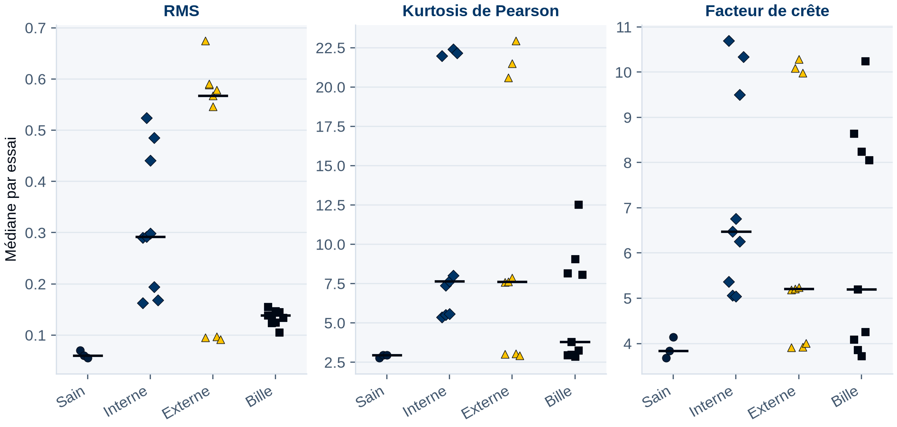
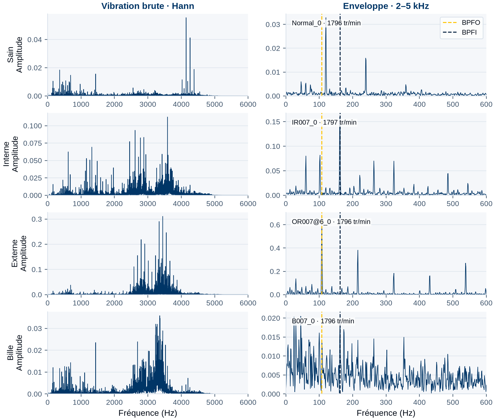
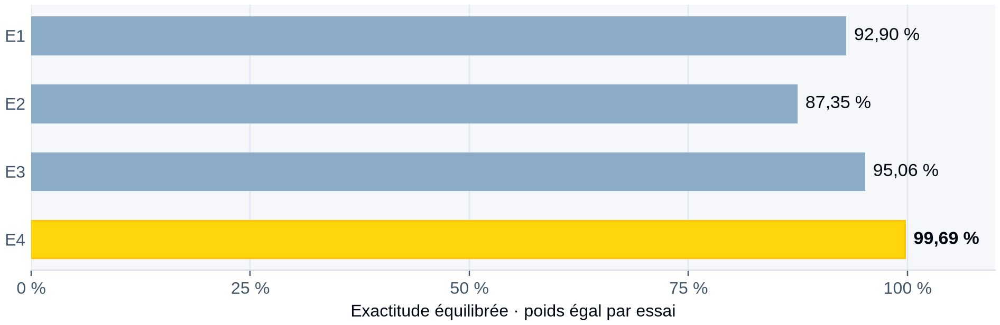
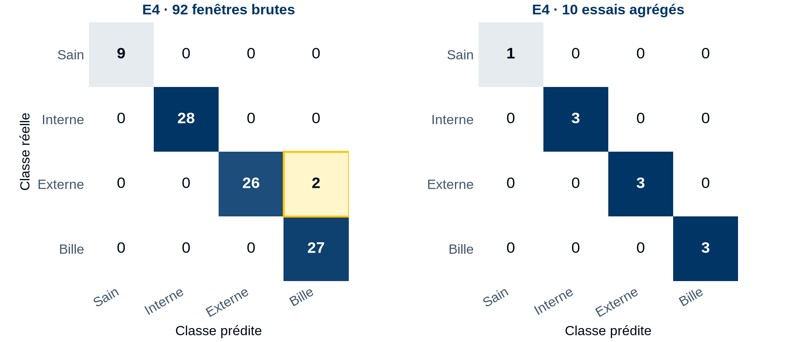
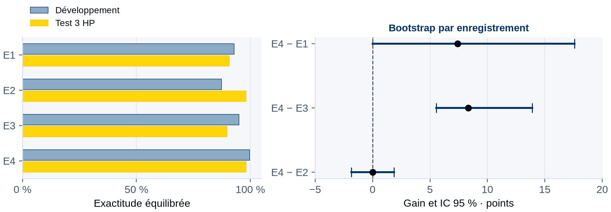

# Mouhamedou Yahya Cheikh Med Vall

# 25239

# Maryeim Mohamed T'Feil

# 22087

# Diagnostic de défauts de roulement par vibration

**AML313 · Groupe 7 · Article scientifique court · 21 novembre 2026**

## Résumé

Nous comparons quatre diagnostics de roulements CWRU à partir de fenêtres vibratoires. La question est de savoir si dix caractéristiques spectrales et d'enveloppe améliorent trois indicateurs temporels, et si le diagnostic tient sur une charge réservée. Le développement compte 30 enregistrements (268 fenêtres) à 0, 1 et 2 HP ; le test final compte 10 enregistrements (92 fenêtres) à 3 HP. Le choix du développement est E4, avec une exactitude équilibrée hors pli de 99,69 %. Les résultats ci-dessous concernent uniquement le banc CWRU et la charge réservée. Ils ne démontrent pas un transfert vers une autre machine.

<!-- RESULTS OVERVIEW -->

## 1. Question et données

Le sujet demande un état sain, une bague interne défectueuse, une bague externe défectueuse ou une bille défectueuse. Notre hypothèse initiale est modeste : les bandes d'enveloppe proches des fréquences de défaut peuvent aider, tandis que le changement de charge peut dégrader les scores. Aucun gain n'était exigé.

Quarante fichiers MAT officiels ont été audités : quatre sains et trente-six défauts, de diamètre 0,007, 0,014 ou 0,021 pouce. Chaque charge de 0 à 3 HP compte un sain et trois essais de chaque défaut. Les quarante empreintes de fichier et de signal sont distinctes ; aucune valeur non finie n'a été trouvée. Deux fichiers sains n'ont pas de vitesse MAT ; leur vitesse de table est signalée comme approximative [1–3].

| Charge (HP) | Sain | Interne | Externe | Bille | Usage |
| ---: | ---: | ---: | ---: | ---: | --- |
| 0, 1, 2 | 3 | 9 | 9 | 9 | Développement |
| 3 | 1 | 3 | 3 | 3 | Test réservé |

**Limite de population.** Les empreintes différentes ne garantissent pas des roulements physiques indépendants. Les fichiers ne donnent ni dates des mesures ni chronologie entre essais.

<!-- PAGE BREAK -->

## 2. Préparation et indicateurs temporels

Les fichiers sains sont identifiés à 48 kHz et ceux des défauts à 12 kHz [1, 3]. Un FIR causal Hamming passe-bas à 4 800 Hz utilise 161 coefficients à 48 kHz et 41 à 12 kHz. Les sains sont décimés par quatre. Les deux voies excluent 0,1 s après ce filtre, puis 0,1 s après le passe-bande. Les fenêtres complètes durent 1 s à 12 kHz, sans recouvrement. Le fragment final incomplet est écarté et compté. La réponse numérique du FIR est proche entre les deux voies, sans rendre identiques leurs acquisitions physiques.

Sur le signal centré de chaque fenêtre, **RMS** = √moyenne(x²), **kurtosis** = moment centré d'ordre quatre normalisé (Pearson, correction d'échantillon), et **facteur de crête** = max|x| / RMS. Une fenêtre dégénérée provoque une erreur. Ces trois variables alimentent E1 et E3 ; aucune charge, étiquette ou vitesse brute n'entre dans X.

Dans cette figure du développement, les essais sains ont un RMS faible ; les défauts montrent des valeurs plus dispersées. Les distributions de kurtosis et de facteur de crête se recouvrent entre classes. L'unité d'accélération numérique n'est pas établie par les pages consultées. Les points représentent des essais, pas des fenêtres indépendantes.

La fréquence native est associée à la classe saine dans ce sous-ensemble. Malgré le filtrage commun, un résidu d'acquisition peut aider à distinguer sain et défaut ; cette confusion possible limite l'interprétation physique.

<!-- PAGE BREAK -->

## 3. Spectre, BPFO/BPFI et enveloppe

Chaque spectre retire la moyenne, applique Hann, puis corrige l'amplitude par la somme des poids. Pour N = 12 000 points à fs = 12 000 Hz, l'espacement des raies est **Δf = fs/N = 1 Hz**. Hann élargit le lobe principal : 1 Hz n'est pas une garantie de séparation de deux pics. L'enveloppe perd 0,05 s à chaque bord ; ses 0,9 s donnent Δf ≈ 1,111 Hz.

Pour le roulement DE et une vitesse r en tr/min, **BPFO = 3,5848 × r/60** et **BPFI = 5,4152 × r/60** [4]. Le passe-bande Butterworth d'ordre 4 couvre 2–5 kHz et avance causalement sur chaque essai. L'enveloppe analytique est calculée sur la fenêtre fermée ; le diagnostic n'est disponible qu'à sa fin. Le filtre a une réponse contrôlée numériquement, mais la résonance optimale d'un roulement donné n'est pas prouvée.

Les dix variables ajoutées sont quatre descripteurs de forme spectrale et six parts d'énergie d'enveloppe près des harmoniques 1–3 de BPFO/BPFI (±3 Hz). Elles sont calculées de la même façon pour toutes les classes. Les deux vitesses saines approximatives rendent leurs bandes moins sûres.

<!-- PAGE BREAK -->

## 4. Validation et ablation sur le développement

La charge 3 HP a été isolée avant les modèles. Trois plis `GroupKFold` utilisent la charge comme supergroupe : chaque validation porte sur une charge entière, soit 10 essais, et l'apprentissage sur les deux autres. Toutes les fenêtres et les dérivés d'un essai restent ensemble. Les quatre expériences partagent les mêmes fenêtres et plis : **E1** arbre + trois variables ; **E2** arbre + treize ; **E3** forêt + trois ; **E4** forêt + treize.

La grille fixée contient profondeurs 3, 6 ou libre et feuilles minimales 1 ou 5 ; la forêt a 200 arbres et la graine 313. La moyenne des exactitudes équilibrées par pli, chaque essai ayant un poids total égal, choisit les paramètres. En cas d'égalité : arbre plus court, puis feuille plus grande ; E1 avant E2 avant E3 avant E4. Réglages retenus : E1 : profondeur 6, feuille 5; E2 : profondeur 6, feuille 5; E3 : profondeur libre, feuille 1; E4 : profondeur 6, feuille 1.

| Modèle | Exact. équilibrée | Exact. pondérée | Macro-F1 | Exact. par essai |
| --- | ---: | ---: | ---: | ---: |
| E1 | 92,90 % | 91,48 % | 92,87 % | 96,67 % |
| E2 | 87,35 % | 91,48 % | 88,86 % | 93,33 % |
| E3 | 95,06 % | 95,56 % | 95,66 % | 96,67 % |
| E4 | 99,69 % | 99,63 % | 99,69 % | 100,00 % |

Différences de l'exactitude équilibrée : E2 - E1 = -5,56 points; E4 - E3 = +4,63 points; E3 - E1 = +2,16 points; E4 - E2 = +12,35 points. Ces scores ont servi à choisir les modèles. Après cette sélection, ils sont optimistes et ne constituent pas une estimation indépendante.

<!-- PAGE BREAK -->

## 5. Transfert réservé à 3 HP

Après gel de la configuration, des empreintes, des variables et des réglages, les quatre expériences ont été réentraînées sur tout le développement. Le marqueur de consultation a été écrit avant l'extraction des fenêtres finales. Les dix essais de 3 HP n'ont servi ni à la grille ni au choix du gagnant.

| Modèle | Exact. équilibrée | Exact. pondérée | Macro-F1 | Exact. par essai |
| --- | ---: | ---: | ---: | ---: |
| E1 | 90,74 % | 88,89 % | 90,69 % | 90,00 % |
| E2 | 98,15 % | 97,78 % | 98,16 % | 100,00 % |
| E3 | 89,81 % | 92,22 % | 91,32 % | 100,00 % |
| E4 | 98,15 % | 97,78 % | 98,15 % | 100,00 % |

Les exactitudes **brutes** par fenêtre sont : E1 89,13 %; E2 97,83 %; E3 92,39 %; E4 97,83 %. Le tableau principal pondère les fenêtres pour que chaque essai compte autant. L'« exactitude par essai » classe la moyenne des probabilités de ses fenêtres. Les deux unités de décision répondent à des questions différentes.

E1 ne classe que neuf essais sur dix : un essai externe est prédit bille. E2, E3 et E4 classent les dix essais correctement. E4 garde toutefois deux erreurs de fenêtre, et son rappel pondéré des fenêtres de bague externe est de 92,59 %. L'agrégation masque donc certaines erreurs de fenêtre. Par rapport au développement, les écarts à 3 HP mêlent changement de charge, changement d'essai et possibles différences entre roulements.

<!-- PAGE BREAK -->

## 6. Incertitude, limites et conclusion

Les ablations finales, en points d'exactitude équilibrée pondérée par essai, sont : E2 - E1 = +7,41 points; E4 - E3 = +8,33 points; E3 - E1 = -0,93 points; E4 - E2 = +0,00 points. Elles décrivent le test réservé ; elles ne déclenchent aucun nouveau choix de modèle.

Le bootstrap apparié tire 1000 fois des **enregistrements** au sein de chaque classe et partage les tirages entre modèles. Exemples de différences : E4 - E1 : +7,41 points [IC bootstrap 95 % : +0,00 ; +17,59] ; E4 - E3 : +8,33 points [IC bootstrap 95 % : +5,56 ; +13,89]. La borne basse du premier intervalle vaut zéro : ce contraste ne garantit pas un gain strict. La classe Sain n'a qu'un essai à 3 HP : sa variabilité entre essais n'est pas estimable. Les intervalles ne couvrent pas le changement de machine.

La décision pratique reste bornée au banc CWRU étudié. Le taux d'erreurs par classe et les confusions guident l'examen d'un essai suspect ; aucune durée de vie restante ni seuil d'intervention n'a été estimé. Les défauts sont artificiels, les unités numériques et l'identité physique des roulements restent partiellement inconnues. Les résultats sont reproductibles avec le manifeste, les empreintes, la configuration gelée et la commande du dépôt.

### Références

[1] CWRU Bearing Data Center, [table des défauts DE à 12 kHz](https://engineering.case.edu/bearingdatacenter/12k-drive-end-bearing-fault-data) et [table des essais sains](https://engineering.case.edu/bearingdatacenter/normal-baseline-data).

[2] CWRU, « Apparatus and Procedures », [description du banc](https://engineering.case.edu/bearingdatacenter/apparatus-and-procedures).

[3] Radtke et Bock, 2022, § 4.1.1, [PHM Society](https://papers.phmsociety.org/index.php/phme/article/download/3329/1947).

[4] CWRU, « Bearing Information », [facteurs DE](https://engineering.case.edu/bearingdatacenter/bearing-information).

[5] AML313, énoncé du mini-projet, sujet 7, p. 10 et grille p. 12.
